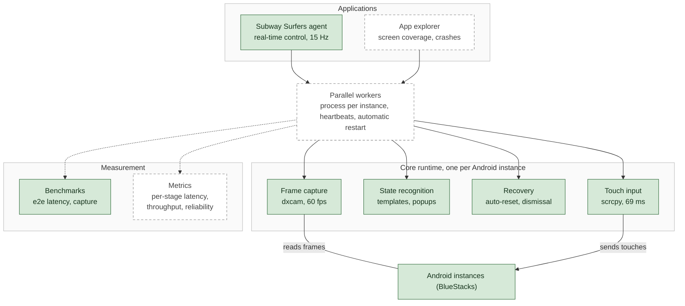

# Q-Train

Q-Train is a real-time platform for vision-based agents that operate Android apps from screen
pixels: low-latency frame capture and touch input, screen-state recognition, automatic
recovery, and measured performance at every stage. It is demonstrated on **Subway Surfers**, a
demanding real-time game; an **app explorer** for automated mobile testing is the next
application.

**Status:** work in progress. Low-latency I/O and hands-free control are complete; reliability,
the app explorer, parallel workers and observability are planned (see [Roadmap](#roadmap)).

Controlling a real app from outside exposes problems a simulator hides: frames must be captured
and touches injected fast enough to act in real time, the app's state has to be inferred from
pixels alone, unexpected screens and popups must be recovered from without a human, and every
interaction runs in real time. Q-Train treats these as engineering problems, measures each one,
and keeps a log of what was optimized and by how much.

## Architecture



Solid green: implemented. Dashed: planned. Applications sit on a shared core runtime, so the
capture, input, recognition and recovery work is reused rather than rebuilt per app.

## Roadmap

Each milestone is defined by the numbers it must produce.

| # | Milestone | Status | Metrics |
|---|---|---|---|
| 1 | Low-latency I/O | Complete | End-to-end input latency 69 ms p50; capture 60 fps |
| 2 | Hands-free control | Complete | 15 Hz control rate; automatic resets and popup handling |
| 3 | Reliability | In progress | Reset time 7.4 → 4.97 s; 49/50 unattended in the first soak test; next: a clean 100+ episode run |
| 4 | App explorer | Planned | Unique screens reached per hour vs. Android's `monkey` tester; crashes found |
| 5 | Parallel workers | Planned | Throughput vs. number of instances; recovery time after injected faults |
| 6 | Observability | Planned | Per-stage latency breakdown (capture, recognition, decision, touch), p50/p95 |

## Results

All measurements: HP Spectre 16 (Core i7-1360P, 16 GB RAM, Windows 11), BlueStacks 5 with an
Android 11 instance. Raw data is in [`results/`](results/).

### Input latency (end to end)

Time from sending a touch until it is visible in the captured frames, detected through
Android's pointer-location overlay (12 presses per path, every press confirmed on screen):

| Input path | p50 | p95 | Registered |
|---|---|---|---|
| Android `input` command via a persistent ADB shell | 203 ms | 236 ms | 12/12 |
| **scrcpy server as an on-device touch injector** | **69 ms** | **93 ms** | 12/12 |
| `cmd input` | n/a | n/a | not implemented on this Android build |

### Frame capture

| Backend | Per frame (p50) | Frames/s |
|---|---|---|
| `adb exec-out screencap` | 619–908 ms | ~1 |
| `mss` (GDI window capture) | 16.9 ms | 58 |
| **`dxcam`** (Desktop Duplication API, time to a new frame) | **16.7 ms** | **60** (game frame rate) |

### Frame source: desktop capture vs. streaming from the device

Two ways to get frames: copy the emulator window from the desktop (dxcam), or decode the device's
own screen streamed by scrcpy's server. Same input path (scrcpy injector) for both.

| | dxcam | scrcpy @ 360 px | scrcpy @ 480 px |
|---|---|---|---|
| End-to-end latency, p50 / p95 (20 presses) | **63 / 92 ms** | 96 / 142 ms | 95 / 128 ms |
| Frames/s at full rate (median of 3) | 51 | **59** | 48 |
| Machine CPU while reading at 15 Hz (median, range of 3) | **27% (25–31)** | 34% (32–35) | 33% (24–36) |
| Window must be visible and on screen | yes | **no** | **no** |
| Needs the screen located inside a window | yes | **no** | **no** |


### Hands-free control: 50-episode soak test (random policy)

| Metric | Before (Oct 25) | Now (Oct 31, 50 episodes, 7 min) |
|---|---|---|
| Control rate achieved | 15.0 Hz | 14.9 Hz, steady across all episodes |
| Reset time (crash to next run) | 7.4 s mean | **4.97 s p50, 6.07 s p95** |
| Share of wall-clock time spent playing | 25% | **40%** |
| Throughput, one instance | ~13,500 steps/hour | **~21,500 steps/hour (+59%)** |
| Episodes completed without help | n/a | 49/50 (one manual popup dismissal; see findings) |
| In-game currency spent | 0 | 0 |

### Findings

- **Input latency reduced ~3x, verified on screen.** Android's `input` command starts a new
  runtime for every touch. Q-Train instead pushes scrcpy's server to the device once and keeps
  it running, so each touch is a 32-byte message over a socket. Most of the remaining 69 ms is
  the display pipeline shared by both paths (Android rendering, emulator compositing, 60 fps
  capture); at 15 decisions per second an action is visible about one control step later.
- **An invalid result, caught and corrected.** An early benchmark timed how long each input
  command took to return, and `cmd input` measured 10 ms, an apparent 60x improvement. On this
  build the command replies `No shell command implementation.` and has no effect; the benchmark
  was timing an error. Latency is now measured end to end, which a no-op cannot pass.
- **Making the end-to-end test observable.** The overlay's crosshair is one device pixel wide,
  under half a pixel after capture and scaling, so the first detector missed every touch. The
  test now watches the overlay's coordinate readout, which changes on every press (866 changed
  pixels per press vs. 0 at rest).
- **Capture is not the bottleneck.** Both desktop capture backends deliver every frame the game
  renders. dxcam initially reported 0.07 ms per frame because it reuses the previous frame when
  the screen is unchanged; it is now measured as time to a new frame.
- **Desktop capture is faster; device streaming is more general.** Streaming adds ~33 ms of
  latency and ~6 points of machine CPU, but works with covered or off-screen windows, many
  instances and any app. The cause is the emulator: BlueStacks offers only Google's *software*
  H.264 encoder (`OMX.google.h264.encoder`), so every streamed frame is compressed on the CPU.
  Resolution doesn't change the latency (360 and 480 px are within noise), so the delay is the
  fixed encode/buffer pipeline, not pixel count. At 360 px the encoder keeps up with 60 fps; at
  480 px it starts dropping frames, so 360 px is the default. Both backends are kept: dxcam for a
  single visible instance where latency matters most, scrcpy for multiple or hidden instances.
- **Measurement noise is real and now quantified.** Single 5-second CPU measurements of the same
  configuration varied from 18% to 76%. Capture benchmarks now run in interleaved rounds and
  report the median with its range, and end-to-end tests discard a warm-up press (the first touch
  of a session takes 220–470 ms vs. 60–100 ms after).
- **Resets dominated wall-clock time; one experiment cut them by a third.** Only 25% of the time
  was spent playing, mostly waiting ~10 s for the "Continue?" prompt to expire rather than spend
  in-game currency. Android Back turned out to dismiss it for free, so "press Back" became a
  first-class screen action: resets fell from 7.4 s to 5.0 s and throughput rose 59%.
- **The soak test found the failure modes a short run can't.** One episode needed a manual
  popup dismissal: the popup sat on top of the score screen, the score screen's template still
  matched, so the bot kept tapping a button the popup covered and never thought it was stuck.
  The controller now detects taps that stop working (same screen after three taps) and escalates
  to closing a popup or pressing Back. A second episode was filed as "lost track"; its saved frame
  showed a crash animation that hid the HUD for over 2 s before "Continue?" appeared, so crashes
  now get 6 s and the HUD-to-crash-screen delay is measured as a metric.

## Optimization log

First solutions are kept only until a measurement shows a better route. Each entry records the
before and after.

| Problem | First approach | Replaced by | Result |
|---|---|---|---|
| Touch input latency | Android `input` command per touch (new runtime each time) | Persistent scrcpy server on the device; 32-byte messages over a socket | 203 → 69 ms end-to-end p50 (~3x) |
| Frame capture rate | `adb exec-out screencap` | Desktop Duplication API (dxcam) | ~1 → 60 fps |
| Validity of latency numbers | Time until the command returns | Time until the touch is visible on screen | Exposed `cmd input` as a no-op that had measured 10 ms |
| Detecting touches on screen | Pointer-overlay crosshair (under half a pixel once captured) | Overlay's coordinate readout | 0/12 → 12/12 touches detected |
| Close-button detection | X-shape score after stretching the glyph to a square | Structural check: white centre and arms, red gaps, relative to the button | 2/5 → 6/6 real popups detected; 0 false positives on notification badges |
| Finding the game in the window | Crop selected by hand, stored as fixed fractions of the window | Automatic detection: strongest 9:16 rectangle of edges, fourth side computed from the shape; re-run when screens go unrecognized | Survives layout changes (an ad panel shifted the game 365 px); exact to the pixel on real captures |
| Frame decoding cost | Every decoded frame converted to a BGR image (40–60/s) | Frames stay in the decoder's format; only frames actually read are converted (15/s at the control rate) | Conversions cut by ~3–4x by construction; scrcpy capture costs this process ~24% of a core at 15 Hz |
| Stream resolution | 720 px | 360 px (the pipeline downsizes to 360x640 anyway) | Machine CPU at 15 Hz 43–51% → 28–34% across runs; full 60 fps instead of dropped frames |
| Cost of finding the game | Full-image running-count tables; every candidate edge as an anchor | Read only the few candidate lines; anchor only on strong edges; uint8 OpenCV differencing | 252 → 84 ms per search (3x), identical results |
| Tap placement | Screen size and orientation from `dumpsys` | Size read from a screenshot header | Taps landed off target → on target |
| Reset time | Wait ~10 s for the "Continue?" prompt to expire | Dismiss it with Android Back (verified to cost no keys); "press Back" as a screen action | 7.4 → 4.97 s p50; time playing 25 → 40%; throughput +59% |
| Silent stuck states | Trust template matches; recover only from unrecognized screens | Detect taps without effect (same screen after 3 taps) and escalate: popup close, then Back | Found by the soak test (1 manual intervention in 50); covered by a regression test |
| Unwanted currency spending | Tap away the "Continue?" prompt; swipes at screen centre | No tap (prompt expires); swipes confined to the lower screen | Keys spent per run: >0 → 0 |

## Setup (Windows)

1. **Emulator.** Install [BlueStacks 5](https://www.bluestacks.com/). In the Multi-Instance
   Manager, create an Android 11 instance and install Subway Surfers from the Play Store.
2. **ADB.** In BlueStacks, enable *Settings > Advanced > Android Debug Bridge* and note the
   address shown (for example `127.0.0.1:5556`; each instance has its own port). Install
   [Android SDK Platform-Tools](https://developer.android.com/tools/releases/platform-tools) and
   add the folder to `PATH`, or set `QTRAIN_ADB` to the full path of `adb.exe`.
3. **scrcpy.** `winget install --id Genymobile.scrcpy`. Q-Train uses its on-device server for
   input and falls back to `adb shell input` if it cannot start.
4. **Python 3.11.**
   ```powershell
   conda create -n qtrain python=3.11 -y
   conda activate qtrain
   pip install -r requirements-dev.txt
   ```

Keep the emulator window visible (not minimized or covered) while any tool is running:
frames are captured from the desktop.

## Usage

### Benchmarks

```powershell
python -m qtrain.bench --list-devices
python -m qtrain.bench --list-windows
python -m qtrain.bench --serial 127.0.0.1:5556 --window "BlueStacks App Player 1" --save-frames
```

End-to-end input latency (open the game's pause screen first, since it is static). Several frame
sources can be compared in one run:

```powershell
python -m qtrain.bench --serial 127.0.0.1:5556 --window "BlueStacks App Player 1" --e2e --e2e-capture dxcam scrcpy
```

| Capture backend | Method |
|---|---|
| `adb` | Device reads back its framebuffer and sends it over ADB |
| `mss` | GDI capture of the emulator window |
| `dxcam` | Windows Desktop Duplication API |
| `scrcpy` | Device's own screen, streamed as H.264 by scrcpy's server and decoded with PyAV; no window needed |

| Input backend | Method |
|---|---|
| `spawn` | New `adb shell input swipe` process per action |
| `shell` | One persistent `adb shell`; commands streamed over stdin |
| `cmd` | Persistent shell with `cmd input`, where Android implements it (auto-detected) |
| `scrcpy` | scrcpy server kept running on the device, injecting touches received over a socket |

### Calibration

```powershell
python -m qtrain.calibrate --window "BlueStacks App Player 1"
```

For each screen (main menu, run in progress, "Continue?" prompt, score screen) the tool asks
you to bring the game to that screen, select a region unique to it, and click where the bot
should tap to leave it. It finishes with a cross-check that flags templates that could match
the wrong screen. Use `--only <screen>` to redo one screen and `--add-popup <name>` to teach a
recurring popup. Calibration is stored in `assets/`, which is not committed because the
templates are crops of the game's artwork.

### Live view

```powershell
python -m qtrain.watch --window "BlueStacks App Player 1"
```

Shows the detected screen, template match scores and any detected close buttons. Press `s` to
save a frame and `q` to quit.

### Running episodes

```powershell
python -m qtrain.run --serial 127.0.0.1:5556 --window "BlueStacks App Player 1" --episodes 5
```

Plays complete episodes with a random policy (reset, play, crash, reset) without user input,
and records steps per episode, reset time, achieved control rate and time spent playing.

### Python API

```python
from qtrain.env import SubwaySurfersEnv

env = SubwaySurfersEnv(serial="127.0.0.1:5556", window="BlueStacks App Player 1")
obs, info = env.reset()          # (4, 84, 84) uint8, stacked grayscale frames
obs, reward, terminated, truncated, info = env.step(env.action_space.sample())
```

Actions: `0` no-op, `1` left, `2` right, `3` jump, `4` roll. Reward: +0.1 per step survived,
-1 on crash.

## How the environment reads the game

- **Game area.** The game is found inside the emulator window automatically: the strongest
  rectangle of sharp edges with the game's 9:16 shape. Three sides must be clear edges and the
  fourth is computed from the shape, which copes with game borders that fade into the frame and
  rejects look-alike lines such as an ad panel's divider. Portrait and landscape are both tried
  (the device's current shape first), so rotating apps work. It runs at startup and again
  whenever screens stop being recognized, so the emulator's layout can change mid-session. With
  `scrcpy` capture, frames are the device's own screen and this step is skipped entirely. The crop is
  resized to a fixed 360x640 canonical image; templates and tap points are stored in canonical
  coordinates, so touches are placed by proportion.
- **Known screens.** Each calibrated screen is recognized by a small template matched near its
  calibrated position (under 1 ms per template). Each has a role (`start`, `playing`, `crash`,
  `dismiss`) that tells the controller what to do.
- **Unknown popups.** Close buttons are found without stored artwork: the detector locates round
  red buttons, then checks that the white mark inside has an X's structure (white centre, four
  white arms, red gaps between them). This rejects the red notification badges with white
  digits that appear throughout the menus. Validated on six real popups and against every digit
  at several badge sizes.
- **Anything else.** The controller waits through transitions, then presses Android Back.
- **In-game currency is never spent.** The "Continue?" prompt is left to expire, and swipes are
  confined to the lower part of the screen so they cannot land on its buttons.

**Known limitation:** the "Continue?" prompt appears after the crash animation, so the crash
penalty arrives after the action that caused it. The delay (HUD vanishing to crash screen) is now
measured in every run as `crash_detection_delay_s`; the HUD vanishing itself is a candidate for
earlier crash detection.

## Project layout

```
qtrain/
  adb.py           ADB device connection, swipe geometry, ADB input backends
  scrcpy_client.py scrcpy server session: touch input and decoded screen frames
  e2e.py           end-to-end input latency (touch sent to touch visible)
  capture.py       DPI-aware window lookup and capture backends
  bench.py         latency benchmark CLI
  vision.py        game-area crop, observations, close-button detector
  screens.py       screen templates, calibration file, classifier
  controller.py    reset/step game loop, independent of Gymnasium and testable with fakes
  env.py           Gymnasium environment
  calibrate.py     interactive calibration
  watch.py         live debug view
  run.py           episode runner with a baseline policy
tests/             unit tests, including a scripted fake game (CI on Ubuntu and Windows)
results/           benchmark and run outputs
```

## Notes

- No game assets, APKs or recorded gameplay are committed; they are not ours to redistribute.
- Runs offline against a local emulator only, never against leaderboards or online events.
