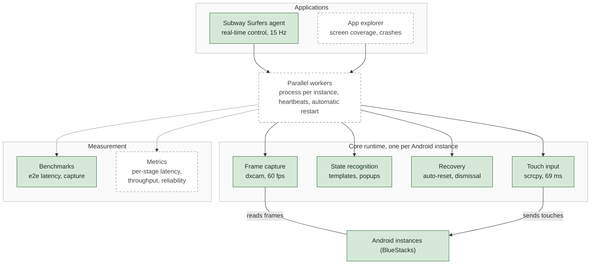

# Q-Train

Q-Train is a real-time platform for vision-based agents that operate Android apps from screen
pixels: low-latency frame capture and touch input, screen-state recognition, automatic
recovery, and measured performance at every stage. It is demonstrated on **Subway Surfers**, a
demanding real-time game; an **app explorer** for automated mobile testing is the next
application.

**Status:** work in progress. Low-latency I/O and hands-free control are complete; reliability,
the app explorer, parallel workers and observability are planned (see [Roadmap](#roadmap)).

Controlling a real app from outside exposes problems a simulator hides: frames must be captured
and touches injected fast enough to act in real time, the app's state has to be inferred from
pixels alone, unexpected screens and popups must be recovered from without a human, and every
interaction runs in real time. Q-Train treats these as engineering problems, measures each one,
and keeps a log of what was optimized and by how much.

## Architecture



Solid green: implemented. Dashed: planned. Applications sit on a shared core runtime, so the
capture, input, recognition and recovery work is reused rather than rebuilt per app.

## Roadmap

Each milestone is defined by the numbers it must produce.

| # | Milestone | Status | Metrics |
|---|---|---|---|
| 1 | Low-latency I/O | Complete | End-to-end input latency 69 ms p50; capture 60 fps |
| 2 | Hands-free control | Complete | 15 Hz control rate; automatic resets and popup handling |
| 3 | Reliability | Next | Reset time (baseline 7.4 s); unattended success rate over 50+ episodes; recoveries per hour |
| 4 | App explorer | Planned | Unique screens reached per hour vs. Android's `monkey` tester; crashes found |
| 5 | Parallel workers | Planned | Throughput vs. number of instances; recovery time after injected faults |
| 6 | Observability | Planned | Per-stage latency breakdown (capture, recognition, decision, touch), p50/p95 |

## Results

All measurements: HP Spectre 16 (Core i7-1360P, 16 GB RAM, Windows 11), BlueStacks 5 with an
Android 11 instance. Raw data is in [`results/`](results/).

### Input latency (end to end)

Time from sending a touch until it is visible in the captured frames, detected through
Android's pointer-location overlay (12 presses per path, every press confirmed on screen):

| Input path | p50 | p95 | Registered |
|---|---|---|---|
| Android `input` command via a persistent ADB shell | 203 ms | 236 ms | 12/12 |
| **scrcpy server as an on-device touch injector** | **69 ms** | **93 ms** | 12/12 |
| `cmd input` | n/a | n/a | not implemented on this Android build |

### Frame capture

| Backend | Per frame (p50) | Frames/s |
|---|---|---|
| `adb exec-out screencap` | 619–908 ms | ~1 |
| `mss` (GDI window capture) | 16.9 ms | 58 |
| **`dxcam`** (Desktop Duplication API, time to a new frame) | **16.7 ms** | **60** (game frame rate) |

### Hands-free control (random-policy baseline)

| Metric | Value |
|---|---|
| Control rate achieved | 15.0 Hz (target 15 Hz) |
| Mean reset time (crash to next run) | 7.4 s |
| Share of wall-clock time spent playing | 25% |
| Throughput, one instance | ~13,500 environment steps/hour |

### Findings

- **Input latency reduced ~3x, verified on screen.** Android's `input` command starts a new
  runtime for every touch. Q-Train instead pushes scrcpy's server to the device once and keeps
  it running, so each touch is a 32-byte message over a socket. Most of the remaining 69 ms is
  the display pipeline shared by both paths (Android rendering, emulator compositing, 60 fps
  capture); at 15 decisions per second an action is visible about one control step later.
- **An invalid result, caught and corrected.** An early benchmark timed how long each input
  command took to return, and `cmd input` measured 10 ms, an apparent 60x improvement. On this
  build the command replies `No shell command implementation.` and has no effect; the benchmark
  was timing an error. Latency is now measured end to end, which a no-op cannot pass.
- **Making the end-to-end test observable.** The overlay's crosshair is one device pixel wide,
  under half a pixel after capture and scaling, so the first detector missed every touch. The
  test now watches the overlay's coordinate readout, which changes on every press (866 changed
  pixels per press vs. 0 at rest).
- **Capture is not the bottleneck.** Both desktop capture backends deliver every frame the game
  renders. dxcam initially reported 0.07 ms per frame because it reuses the previous frame when
  the screen is unchanged; it is now measured as time to a new frame.
- **Resets dominate wall-clock time.** Only 25% of the time is spent playing, mostly because
  the bot waits for the "Continue?" prompt to expire rather than spend in-game currency. This is
  the largest single-instance throughput lever ahead of stage 3.

## Optimization log

First solutions are kept only until a measurement shows a better route. Each entry records the
before and after.

| Problem | First approach | Replaced by | Result |
|---|---|---|---|
| Touch input latency | Android `input` command per touch (new runtime each time) | Persistent scrcpy server on the device; 32-byte messages over a socket | 203 → 69 ms end-to-end p50 (~3x) |
| Frame capture rate | `adb exec-out screencap` | Desktop Duplication API (dxcam) | ~1 → 60 fps |
| Validity of latency numbers | Time until the command returns | Time until the touch is visible on screen | Exposed `cmd input` as a no-op that had measured 10 ms |
| Detecting touches on screen | Pointer-overlay crosshair (under half a pixel once captured) | Overlay's coordinate readout | 0/12 → 12/12 touches detected |
| Close-button detection | X-shape score after stretching the glyph to a square | Structural check: white centre and arms, red gaps, relative to the button | 2/5 → 6/6 real popups detected; 0 false positives on notification badges |
| Tap placement | Screen size and orientation from `dumpsys` | Size read from a screenshot header | Taps landed off target → on target |
| Unwanted currency spending | Tap away the "Continue?" prompt; swipes at screen centre | No tap (prompt expires); swipes confined to the lower screen | Keys spent per run: >0 → 0 |

## Setup (Windows)

1. **Emulator.** Install [BlueStacks 5](https://www.bluestacks.com/). In the Multi-Instance
   Manager, create an Android 11 instance and install Subway Surfers from the Play Store.
2. **ADB.** In BlueStacks, enable *Settings > Advanced > Android Debug Bridge* and note the
   address shown (for example `127.0.0.1:5556`; each instance has its own port). Install
   [Android SDK Platform-Tools](https://developer.android.com/tools/releases/platform-tools) and
   add the folder to `PATH`, or set `QTRAIN_ADB` to the full path of `adb.exe`.
3. **scrcpy.** `winget install --id Genymobile.scrcpy`. Q-Train uses its on-device server for
   input and falls back to `adb shell input` if it cannot start.
4. **Python 3.11.**
   ```powershell
   conda create -n qtrain python=3.11 -y
   conda activate qtrain
   pip install -r requirements-dev.txt
   ```

Keep the emulator window visible (not minimized or covered) while any tool is running:
frames are captured from the desktop.

## Usage

### Benchmarks

```powershell
python -m qtrain.bench --list-devices
python -m qtrain.bench --list-windows
python -m qtrain.bench --serial 127.0.0.1:5556 --window "BlueStacks App Player 1" --save-frames
```

End-to-end input latency (open the game's pause screen first, since it is static):

```powershell
python -m qtrain.bench --serial 127.0.0.1:5556 --window "BlueStacks App Player 1" --e2e
```

| Capture backend | Method |
|---|---|
| `adb` | Device reads back its framebuffer and sends it over ADB |
| `mss` | GDI capture of the emulator window |
| `dxcam` | Windows Desktop Duplication API |

| Input backend | Method |
|---|---|
| `spawn` | New `adb shell input swipe` process per action |
| `shell` | One persistent `adb shell`; commands streamed over stdin |
| `cmd` | Persistent shell with `cmd input`, where Android implements it (auto-detected) |
| `scrcpy` | scrcpy server kept running on the device, injecting touches received over a socket |

### Calibration

```powershell
python -m qtrain.calibrate --window "BlueStacks App Player 1"
```

For each screen (main menu, run in progress, "Continue?" prompt, score screen) the tool asks
you to bring the game to that screen, select a region unique to it, and click where the bot
should tap to leave it. It finishes with a cross-check that flags templates that could match
the wrong screen. Use `--only <screen>` to redo one screen and `--add-popup <name>` to teach a
recurring popup. Calibration is stored in `assets/`, which is not committed because the
templates are crops of the game's artwork.

### Live view

```powershell
python -m qtrain.watch --window "BlueStacks App Player 1"
```

Shows the detected screen, template match scores and any detected close buttons. Press `s` to
save a frame and `q` to quit.

### Running episodes

```powershell
python -m qtrain.run --serial 127.0.0.1:5556 --window "BlueStacks App Player 1" --episodes 5
```

Plays complete episodes with a random policy (reset, play, crash, reset) without user input,
and records steps per episode, reset time, achieved control rate and time spent playing.

### Python API

```python
from qtrain.env import SubwaySurfersEnv

env = SubwaySurfersEnv(serial="127.0.0.1:5556", window="BlueStacks App Player 1")
obs, info = env.reset()          # (4, 84, 84) uint8, stacked grayscale frames
obs, reward, terminated, truncated, info = env.step(env.action_space.sample())
```

Actions: `0` no-op, `1` left, `2` right, `3` jump, `4` roll. Reward: +0.1 per step survived,
-1 on crash.

## How the environment reads the game

- **Game area.** The emulator window is cropped to the game and resized to a fixed 360x640
  canonical image. Templates and tap points are stored in canonical coordinates, so moving or
  resizing the window does not invalidate calibration, and touches are placed by proportion.
- **Known screens.** Each calibrated screen is recognized by a small template matched near its
  calibrated position (under 1 ms per template). Each has a role (`start`, `playing`, `crash`,
  `dismiss`) that tells the controller what to do.
- **Unknown popups.** Close buttons are found without stored artwork: the detector locates round
  red buttons, then checks that the white mark inside has an X's structure (white centre, four
  white arms, red gaps between them). This rejects the red notification badges with white
  digits that appear throughout the menus. Validated on six real popups and against every digit
  at several badge sizes.
- **Anything else.** The controller waits through transitions, then presses Android Back.
- **In-game currency is never spent.** The "Continue?" prompt is left to expire, and swipes are
  confined to the lower part of the screen so they cannot land on its buttons.

**Known limitation:** the "Continue?" prompt appears about a second after the collision, so the
crash penalty arrives slightly after the action that caused it.

## Project layout

```
qtrain/
  adb.py           ADB device connection, swipe geometry, ADB input backends
  scrcpy_input.py  scrcpy server as an on-device touch injector
  e2e.py           end-to-end input latency (touch sent to touch visible)
  capture.py       DPI-aware window lookup and capture backends
  bench.py         latency benchmark CLI
  vision.py        game-area crop, observations, close-button detector
  screens.py       screen templates, calibration file, classifier
  controller.py    reset/step game loop, independent of Gymnasium and testable with fakes
  env.py           Gymnasium environment
  calibrate.py     interactive calibration
  watch.py         live debug view
  run.py           episode runner with a baseline policy
tests/             unit tests, including a scripted fake game (CI on Ubuntu and Windows)
results/           benchmark and run outputs
```

## Notes

- No game assets, APKs or recorded gameplay are committed; they are not ours to redistribute.
- Runs offline against a local emulator only, never against leaderboards or online events.
